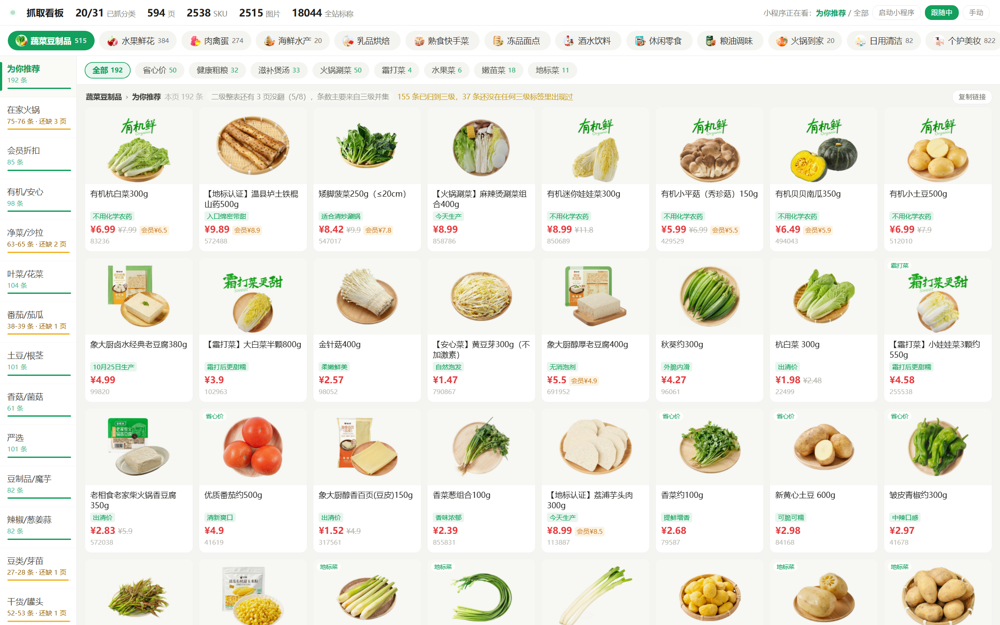

# Xiaoxiang Market Capture

Reads the API responses behind the category pages of the WeChat mini program "Xiaoxiang Market" (小象超市), stores them as local JSON, downloads the product images, and serves a local dashboard showing capture progress.

> [简体中文](README.md) | **English**

- Only reads responses the mini program already received; no replay, no modified parameters
- Dashboard listens on `127.0.0.1:8899` only
- Works with manual scrolling, or lets the script page through at a fixed pace




## What it is for

The point is to hand the whole price list to an AI and have it work out what to buy, not to redistribute data. In practice:

- **Picking food** — out of a thousand-plus items on sale, narrow down what is worth buying this week instead of scrolling the app for ten minutes and still not deciding
- **Comparing prices** — compute unit prices across the same product, e.g. `230g × 6` versus loose 500g, or a discount price against the usual one
- **Planning meals** — work backwards from the ingredients you bought to dishes you can actually cook, so less food spoils

The output is structured JSON with name, price, spec, tags and category, ready to feed to a model as-is.

## Requirements

| | |
| --- | --- |
| OS | Windows 10 / 11 |
| Python | 3.10+ |
| Node.js | 18+ |
| WeChat for Windows | 4.1.15.56 (other builds need an updated offset table) |

## Install

```bat
git clone https://github.com/Horizen5/xiaoxiang-capture.git
cd xiaoxiang-capture

pip install -r tools\requirements.txt
cd tools\wmpfdebugger && npm install && cd ..\..
```

## Usage

Two launch scripts are included:

| Script | Behaviour |
|---|---|
| `启动抓包.bat` | Runs in the background. Double-click and it goes; the dashboard page opens by itself once it is up. Double-clicking again while it runs only reopens the page, it does not start a second copy |
| `start_beta.bat` | Runs in the foreground, so the window shows progress such as "调试代理已就绪" and "小程序已连上". Use this one when something goes wrong |

From a shell, `--daemon` detaches from the current terminal:

```bat
python tools\start_beta.py --daemon
```

Steps:

1. Double-click `启动抓包.bat`
2. Close the mini program completely (close the window, navigating back does not count)
3. Open it again and go to the category page
4. Scroll through the pages; the counters on the dashboard update as you go

The mini program must be started after the launcher. The CDP session is attached when the mini program process starts, so one that is already running will not be picked up.

The dashboard is at <http://127.0.0.1:8899/>.

## Data

Everything is written under `tools/` at runtime and is not committed:

```
tools/live_raw/
├── c1003_f0_t0_o0.json      # level2 1003, level1 0, level3 0, offset 0
├── _meta.jsonl              # one line per page: time, category, count, code
├── _category_tree.json      # category tree with declared counts
├── _current.json            # which category the mini program is on
└── _risk.json               # verification prompts seen

tools/live_imgs/             # product images, original CDN filenames
```

Product fields live under `data.contents[0].subModule.contents[0].showContents...singleDataInfo`: name, price, spec, tags and SKU id. `samples/` contains one real page and a trimmed category tree so you can see the format without running anything. Field-by-field notes are in [docs/数据说明.md](docs/数据说明.md) (Chinese).

`make_image_index.py` writes `image_index.csv` mapping SKU to product name and filename. With `--link` it also creates hard links named after the products, which costs no extra disk space.

## Layout

```
xiaoxiang-capture/
├── 启动抓包.bat            # entry point, runs in background
├── start_beta.bat           # foreground run, shows progress
├── tools/
│   ├── start_beta.py        # launcher, supervises the three processes
│   ├── start_hidden.bat     # source of 启动抓包.bat (GBK encoded)
│   ├── _mkbat.py            # regenerates it; edit the LINES list there
│   ├── live_capture.py      # capture, reads responses over CDP
│   ├── monitor_server.py    # dashboard server
│   ├── make_image_index.py  # image index generator
│   ├── _open_mini.py        # opens the mini program
│   ├── _pidutil.py          # pid file handling
│   └── wmpfdebugger/        # debug proxy, third-party
├── docs/
└── samples/
```

How the three processes connect:

```
mini program ──CDP(62000)── wmpfdebugger ──▶ live_capture.py ──▶ live_raw / live_imgs
                                                                      │
                                                      monitor_server.py(8899) ──▶ dashboard
```

`start_beta.py` starts and restarts them. It looks for node in a few known locations and prints a message if none is found, rather than retrying forever.

## Implementation notes

**CDP instead of a proxy.** The mini program talks over WMPF's own channel, so a normal HTTP proxy sees nothing readable. CDP connects to the renderer and hooks `wx.request`, which hands over structured objects directly. No decryption, no certificates.

**PID files store three fields.** Windows reuses PIDs. After a process exits, its number can be taken by something else. Checking only "is this PID alive" makes the launcher believe another copy is still running, and a cleanup pass can kill the wrong process. The file records `pid:image name:creation time`, and all three must match.

**Pacing.** Passive capture needs no rate limit. When the script pages on its own it waits 2.1 seconds per page. That number came from measurement: 613 requests, none returned a non-zero code, fastest sustained rate 1.67 seconds, leaving 20% headroom. It also calls exactly one paging method at a time; calling several at once drops the mini program to 0.5 seconds per page, which is when the verification slider shows up.

**Dashboard counts.** Declared counts come from `skuCount` in `_category_tree.json`. Incomplete categories render as `captured-declared` in amber; complete ones show just the actual count. Reaching the end of the list counts as complete, since some categories declare 31 items but only return 24.

**Starting twice.** A second launch probes port 8899 first. If the service is alive it opens the dashboard page and prints "已启动网页" without spawning anything; if the pid record is there but the process is gone, the old one is cleared and everything restarts.

**Running in the background.** `start_beta.py --daemon` relaunches itself with `DETACHED_PROCESS` and exits, so the service is not tied to the terminal that started it. The `启动抓包.bat` batch file uses that path.

**The batch file is stored as GBK.** cmd reads batch files using the system ANSI code page; saved as UTF-8 the Chinese prompts turn into question marks. To change `启动抓包.bat`, edit the `LINES` list in `tools/_mkbat.py` and regenerate it rather than editing the batch file directly.

## Known issues

- WeChat for Windows has no external deep link for mini programs. `weixin://launchapplet` exists in `Weixin.dll` but only works when called from inside the WeChat process. `weixin://dl/business/?appid=` needs a token issued by the server and otherwise lands on a blank page. The fallback is UI automation, or the `.lnk` WeChat creates for "add to desktop".
- The debug flag is per process. Once injected, `RemoteDebugMode` stays set until WeChat restarts, so a clean state requires fully quitting WeChat.
- Offsets are tied to a specific WeChat build and may break after an update.

## FAQ

**Does capturing trigger the anti-bot check?**

Passive capture does not. Scripted paging runs at 2.1 seconds per page and has not triggered it.

**Why are images named with numbers?**

They keep their original CDN filenames. 312 product names contain characters such as `*` and `?` that cannot be used in Windows filenames.

**Why does antivirus flag it?**

The debug proxy injects code into the WeChat process, which looks like malware behaviour. The full source is here if you want to check.

**I double-clicked and no browser appeared.**

The page opens once the dashboard is up, so give it a couple of seconds. If nothing shows, open <http://127.0.0.1:8899/> yourself. The server only listens on 127.0.0.1 and is not reachable from other machines.

**The "启动小程序" button does nothing.**

When WeChat is minimised to the tray its window still exists but `IsWindowVisible` returns false, and an earlier version gave up at that point. It now falls back to the hidden window and brings it back. If it still fails, click the WeChat icon in the tray first to show the main window.

## Credits

- [wmpfdebugger](https://github.com/evi0s/wmpfdebugger): WMPF debug proxy; this project adds environment scrubbing on top
- [Frida](https://frida.re/): runtime injection

## Notice

This project is for personal study and data analysis. It is not affiliated with, authorised by, or endorsed by Meituan or Xiaoxiang Market.

Only public product information visible to the owner's own account is read: name, price, spec, tags and image. No credentials, payment details or other users' data are touched, and no private endpoint is called.

The data is used to feed an AI with grocery prices for personal shopping decisions — what to buy, what is cheaper by unit, what can be cooked. It is not offered as a data service, not redistributed, and not used commercially.

If any content, screenshot or method in this repository infringes your rights, please open an [Issue](https://github.com/Horizen5/xiaoxiang-capture/issues) explaining the situation. I will remove the offending content and stop updating the project once verified.

Check whether this complies with the target platform's terms of service and your local law before use. You are responsible for any consequences of using this project.

## License

[MIT](LICENSE). `tools/wmpfdebugger/` remains under its original GPL-2.0.
