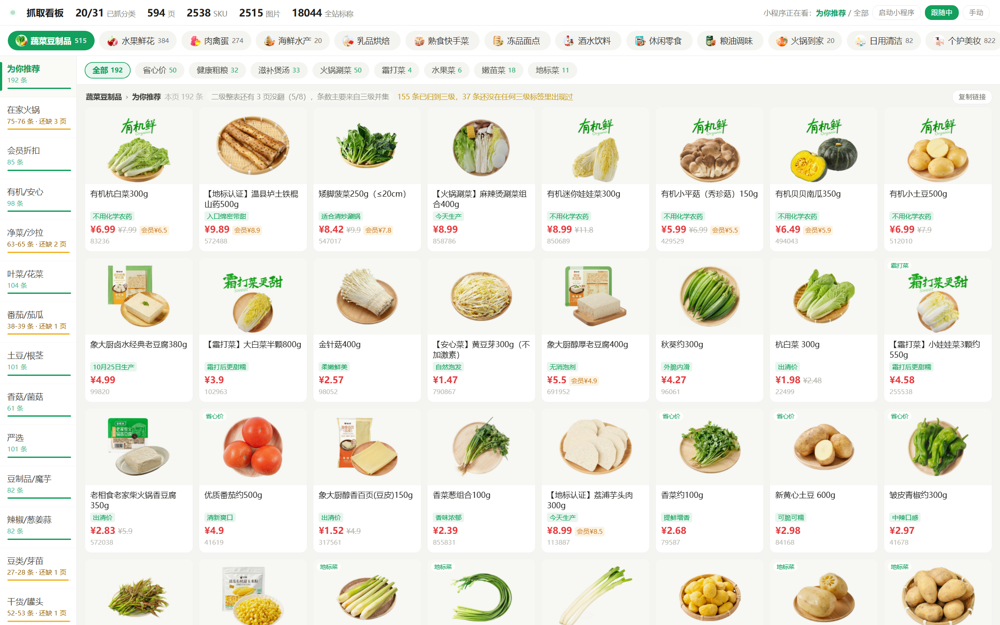

<h1 align="center">小象超市 · 抓包与实时看板</h1>

<p align="center"><strong>把小程序里一屏一屏翻出来的商品，抄成一份能看、能查、能补的本地数据。</strong></p>

<p align="center">
  
  
  
  
  
</p>

<p align="center">
  <a href="#这是什么">这是什么</a> ·
  <a href="#看板">看板</a> ·
  <a href="#怎么跑">怎么跑</a> ·
  <a href="#数据长什么样">数据</a> ·
  <a href="#几个踩过的坑">风控</a> ·
  <a href="#常见问题">常见问题</a>
</p>

<p align="center">
  
</p>

---

## 这是什么

小程序的「分类」页是个漏斗：31 个一级分类，每个下面十几个二级，二级再拆三级，商品只能一屏一屏往下翻。
翻完了也就翻完了，下一次打开又从第一屏开始——想知道**某个三级分类到底有多少商品、哪些还没看到**，靠眼睛是数不出来的。

这个项目做的是：在小程序的渲染进程里挂个钩子，把它**自己请求回来的接口响应**原样抄一份存到本地，
再用一个复刻小程序分类页布局的看板实时显示「这个分类抓了多少 / 标称多少」。

截至最后一次抓取：**31 个一级分类已抓 20 个，594 个页数据，2538 个 SKU，2515 张商品图，全站标称 18044 条**。

三条底线：

- **不破解、不重放、不伪造请求。** 不修改任何业务参数，不发一条小程序自己没发过的包，只是把响应复制一份。
- **看板纯本地。** `127.0.0.1:8899`，不监听外网、不上报、不联网。
- **不绕过风控。** 抓取节奏按实测出来的安全线走，宁可慢，不去撞滑块。

## 看板

<p align="center">
  
  
  <br>
  <sub>左：一级分类条 + 二级侧栏，未抓满的显示「75-76 条 · 还缺 3 页」黄字　　右：三级分类下的商品卡，价格 / 规格 / 标签 / SKU 号</sub>
</p>

顶部一行是全局进度（已抓分类 / 页数 / SKU / 图片 / 全站标称），左侧是二级分类及缺口，中间是三级分类的
胶囊筛选和商品网格。布局按小程序原版复刻，所以对着小程序滑一屏，看板上就是同一屏商品，方便逐页核对。

未抓满的分类标黄：`已抓-标称`。抓满了只显示实际条数——如果接口已经翻到底（`end`），也算抓满，
因为有些分类标称 31 条、实际只给 24 条（下架或无货），否则会永远挂着黄字。

## 怎么跑

**环境**：Windows 10 / 11、Python 3.10+、Node.js 18+、微信 PC 版 4.x（已登录）
当前适配微信 **4.1.15.56**，其他版本可能需要更新 `tools/wmpfdebugger/frida/config`。

```bat
:: 1. 安装依赖
pip install -r tools\requirements.txt
cd tools\wmpfdebugger && npm install && cd ..\..

:: 2. 双击启动（也可以命令行跑 start_beta.py）
start beta.bat
```

**操作顺序**（重要）：

1. 先把微信里的「小象超市」小程序**完全关掉**（不是退到上一页，是真正关闭窗口）
2. 双击 `start beta.bat`，等它打印「调试代理已就绪」
3. 再打开小程序，进到「分类」页
4. 浏览器开 `http://127.0.0.1:8899/`，点右上角「启动小程序」也能一键拉起（见下方说明）
5. 手动上下滑动翻页，看板上的数字实时涨

> 小程序**必须在启动器之后**打开。CDP 连接是在小程序进程启动时建立的，先开的接管不到。

## 三个进程

| 进程 | 端口 | 职责 |
| --- | --- | --- |
| `wmpfdebugger`（node） | 62000 | 给 WMPF 运行时打补丁，把 DevTools 协议暴露出来 |
| `live_capture.py` | — | 连 CDP，注入 hook，抄响应、落 JSON、下图片 |
| `monitor_server.py` | 8899 | 只读扫描落盘文件，渲染看板 |

`start_beta.py` 是这三者的守护进程：负责找 node / python（WorkBuddy 自带的 node 不在 PATH 里也能找到）、
按顺序拉起、挂了自动重拉，并把自己和子进程的 pid 写成带身份的文件。

## 数据长什么样

```
tools/live_raw/
├── c1003_f0_t0_o0.json          # 二级1003 一级0 三级0 偏移0
├── _meta.jsonl                  # 每页一行：时间、分类、条数、code
├── _category_tree.json          # 分类树（含每个三级的标称 skuCount）
├── _current.json                # 小程序当前停在哪个分类
└── _risk.json                   # 风控记录（有没有弹过验证）
tools/live_imgs/
└── <CDN 原文件名>.jpg
```

字段路径是 `data.contents[0].subModule.contents[0].showContents[elementId][].elementInfo.singleDataInfo`，
商品名 / 价格 / 规格 / 标签 / SKU 号都在里面。`samples/` 里放了一页真实数据和一个精简分类树，
不用跑起来也能看懂格式，细节见 [docs/数据说明.md](docs/数据说明.md)。

图片保留 CDN 原文件名（数字名）作为主键，因为 312 个商品名里带 Windows 非法字符（比如 `230g*6袋`）。
需要按商品名找人，跑 `make_image_index.py --link` 会额外建一份硬链接，不占空间。

## 几个踩过的坑

### 为什么用 CDP 而不是 MITM

小程序走 WMPF 的自定义通道，常规代理抓不到明文。CDP 直接连渲染进程，钩住 `wx.request`，
拿到的就是结构化对象，不需要解密、不需要证书。

代价是这条路会**改变运行环境**：调试模式会把 `RemoteDebugMode` 置 1，而这是进程级开关，
只有微信进程重启才复位。所以抓完之后想让环境回到干净状态，必须彻底退出微信
（任务管理器确认没有 `Weixin.exe` 和 `WeChatAppEx.exe`）。

### 风控：不是"少发点"就行，是"别乱发"

踩过两次滑块验证，第二次只开了 12 秒自动模式就弹了。归因下来全是"请求长得不像人"：

| 问题 | 现象 | 处理 |
| --- | --- | --- |
| 脚本盲调页面方法（`activeThirdCategory` 等 4 个，参数靠猜） | 页面状态乱，随后发出不匹配的请求 | 删掉，不再代点页面按钮 |
| 一次同时调 `loadNextPage` + `loadNextPageDebounce` + `onReachBottom` | 同一秒翻两三页，0.5 秒/页 | 只调一个，且硬节流 2.1 秒 |
| 守护循环每 2 秒开短连接探 `Target.getTargets` | 和长连接抢 CDP 通道，会话抖动 | 连上后不再探测 |
| WMPF 注入的 `__isAppServiceRemoteDebugMode__` / `__remoteDebug__` / `__debuggerMessager__` | 页面自检能读到"我在被调试" | hook v6 擦除，自检返回 `clean` |

节奏是实测出来的，不是拍的：翻了 613 次真实请求，响应 `code` 全为 0，最快持续 **1.67 秒/次**，
中位 2.03 秒，60 秒最多 34 次。自动补页取 **2.1 秒/页**（≈ 1.67 / 0.8），留 20% 余量。

### 为什么 pid 文件要存三个字段

Windows 会复用 pid。上一轮进程退出后，它占的 pid 可能被别的程序捡走；
如果只判断"这个 pid 还活着"，启动器会永久以为"已经有一份在跑"，然后直接退出——
而且清理残留进程时还会把这个无辜进程杀掉。

所以 `_pidutil.py` 记的是 `pid:可执行文件名:创建时间`，三者全对上才算同一个进程。

### 看板的数字口径

三级分类的标称数量来自 `_category_tree.json` 的 `skuCount`（2299 个三级节点全都有值）。
显示规则的判断顺序是：接口翻到底 → 抓够标称 → 否则标黄。只按标称判断会让"标 31 实给 24"的分类永远挂黄。

## 常见问题

**PC 微信能不能用一条命令直接唤起小程序？**

不能。`weixin://launchapplet` 确实存在于 `Weixin.dll` 里，但它只接受微信进程**内部**调用，
外部 `startfile` 会被忽略。`weixin://dl/business/?appid=` 需要服务端签发的 `t` 令牌，否则落到白页；
`weixin://dl/jumpWxa/?userName=` 需要小程序的 `gh_` 号，藏在加密库里。
唯一能唤起的是 `weixin://appex/launchgame`，但它开的是「微信游戏」窗口。

所以看板上的「启动小程序」是按优先级找替代路径：已有窗口 → 置前；桌面快捷方式 → 直接起；
都没有 → UI 自动化（置前 + Ctrl+F + 输入 + 回车），实测 2.85 秒。

**想要真正秒开的硬调用怎么办？**

在小程序右上角「…」→「添加到桌面」，那个 `.lnk` 里是微信自己写的完整启动参数，
等于官方硬入口。把 `.lnk` 放到桌面或 `tools/` 下，按钮会自动优先用它。

**抓的时候会不会被风控？**

只做旁路记录（你手动翻，它只抄）不限速也不会触发——613 次请求 code 全 0。
只有脚本自己补页时才需要控节奏，见上文。

**图片为什么是数字名？**

CDN 原名。改成商品名会有 312 个文件因为 `*` `?` 之类的字符写不进去，主键稳定比可读性重要。
`make_image_index.py` 生成的 CSV 里有完整的 SKU ↔ 商品名 ↔ 文件名对应。

**微信升级后抓不到了？**

先看 `_env.json` 自检是不是 `clean`。偏移是版本相关的，升级后可能需要更新
`tools/wmpfdebugger/frida/config` 里的偏移表，具体见 [docs/部署与排错.md](docs/部署与排错.md)。

## 目录结构

```
xiaoxiang-capture/
├── start beta.bat            # 双击入口
├── tools/
│   ├── start_beta.py         # 启动器：找 node/python、拉三个进程、常驻守护
│   ├── live_capture.py       # 抓包记账（含注入的 hook 源码）
│   ├── monitor_server.py     # 看板 HTTP 服务
│   ├── make_image_index.py   # 生成 SKU ↔ 图片索引 CSV
│   ├── _open_mini.py         # 一键打开小程序（窗口在位优先，UI 自动化兜底）
│   ├── _pidutil.py           # pid 文件读写 + 防 pid 复用
│   ├── _win_shot.py          # 窗口截图（PrintWindow，验证 UI 用）
│   ├── requirements.txt
│   └── wmpfdebugger/         # 第三方调试代理源码（GPL-2.0，见其 README）
├── docs/
│   ├── 架构.md               # 三个进程怎么配合、数据流
│   ├── 数据说明.md           # 文件命名、字段含义
│   ├── 部署与排错.md         # 环境、常见故障
│   └── screenshots/
└── samples/                  # 一页真实数据 + 精简分类树
```

运行时生成、**不进仓库**：`tools/live_raw/`（页数据）、`tools/live_imgs/`（商品图）。

## 致谢

- [wmpfdebugger](https://github.com/evi0s/wmpfdebugger) —— WMPF 调试代理，本项目在其基础上加了 hook v6 的环境擦除
- [Frida](https://frida.re/) —— 运行时注入
- Chrome DevTools Protocol —— 抓包与页面调试的通道

## 许可

[MIT](LICENSE)。`tools/wmpfdebugger/` 沿用其原项目的 **GPL-2.0**，不适用本仓库的 MIT。

## 免责声明

仅用于**个人学习与数据分析**，抓取的是自己账号在小程序里本来就能看到的公开商品信息。
请勿用于商业爬取、批量倒卖或对目标服务造成压力。使用前请自行确认符合目标平台的服务条款与当地法律法规。
